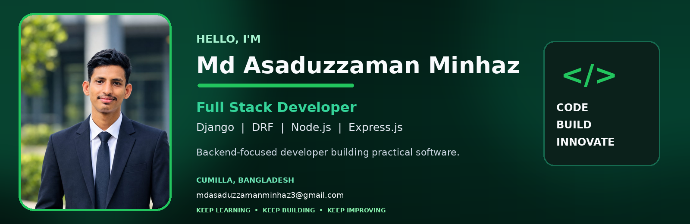

# Md Asaduzzaman Minhaz

### Full Stack Developer · Backend-Focused · REST API Development

Dhaka, Bangladesh ·  **mdasaduzzamanminhaz3@gmail.com**

---

##  About Me

I'm a **Computer Science & Technology student from Bangladesh** with a strong interest in backend engineering and full-stack web development. I enjoy turning ideas into practical applications, designing REST APIs, working with databases, and learning how to build reliable software.

- 🔭 Building full-stack applications with **Django, Django REST Framework, Node.js, Express.js, React, and Next.js**.
- ⚙️ Interested in backend architecture, API development, authentication, and database design.
- 🧩 Focused on strengthening **Data Structures & Algorithms, Python OOP, and problem-solving**.
- 🌱 Currently learning **System Design, database optimization, TypeScript, and Docker**.
- 🎯 Career goal: grow as a software engineer and contribute to products that solve real problems.

> I value clean code, continuous learning, and building software that is useful beyond the demo.

## 🧰 Technical Skills

### Languages

  

### Backend Development

  
  

### Frontend Development

  
  

### Databases & Data

  

### Authentication & API

  
  
  
  
  

### Tools, Platforms & Deployment

  
  
  
  
  

## 🚀 Featured Projects

The projects below demonstrate my experience building applications across backend APIs, frontend interfaces, authentication, databases, and deployment.

### 1. Ayojon — Event Management Platform

A full-stack event management platform where users can explore events, create events, and manage their participation.

**Highlights**
- Event creation and management
- Event categories and event discovery
- Join and cancel event functionality
- Authentication and user-specific event management
- Separate client and server applications

**Tech:** Next.js · React · TypeScript · Node.js · Express.js · MongoDB · Tailwind CSS

  
  
  

### 2. NewsIque — Online Newspaper & Subscription Platform

An online newspaper platform designed to manage news content and provide premium subscription functionality.

**Highlights**
- News publishing and management
- User authentication and role-based access
- Premium subscription functionality
- PostgreSQL-backed application data
- Cloudinary media integration

**Tech:** Python · Django · Django REST Framework · PostgreSQL · Cloudinary

  
  
  

### 3. Eco-Track — Waste Management & Recycling Platform

An eco-friendly platform that encourages responsible waste management through pickup requests, recycler verification, green rewards, and environmental impact tracking.

**Highlights**
- Waste pickup request management
- Recycler verification
- Green rewards concept
- Environmental impact tracking

**Tech:** Python · Django · Django REST Framework · JWT Authentication

  
  
  

## 📈 GitHub Activity

## 🌱 Currently Learning

- Data Structures & Algorithms
- Advanced Python and Python OOP
- TypeScript and Next.js
- Database Optimization
- System Design
- Docker and containerization

## 🤝 Let's Connect

I'm always interested in connecting with developers, learning from others, and discussing meaningful software projects.

  
  
  
  
  

### 💡 Keep Learning. Keep Building. Keep Improving.

**Code · Build · Innovate**

Thanks for visiting my profile! Feel free to explore my repositories and connect with me.

